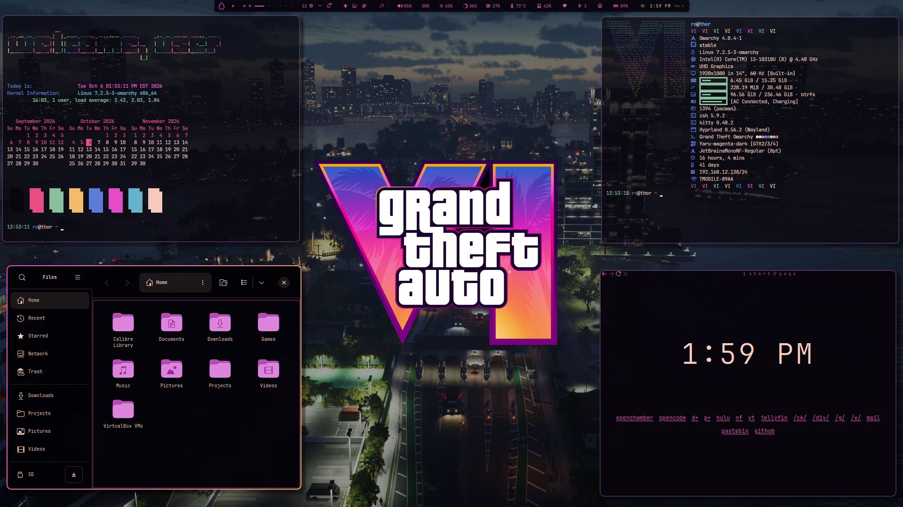

<pre style="line-height: 1.0; font-family: monospace; letter-spacing: 0px;">
⠹⣽⣿⣿⣿⣿⣿⣟⣆⠀⠀⠀⣼⣿⣿⢿⡿⣿⢿⣭⢻⣽⣿⣿⢿⡿⣿⣿
⠀⠹⣿⣻⣽⢿⣻⣿⣾⣆⠀⣰⣿⣿⣻⣟⢿⣽⣻⠃⢸⣯⢿⣟⣯⣿⢿⣿
⠀⠀⢹⣿⢯⣟⣯⢷⣟⣾⣴⣿⡻⢾⡵⣞⣯⣾⠃⠀⢸⡽⣏⡿⢧⣟⢯⣿
⠀⠀⠀⢻⡷⣺⡝⣞⡮⣗⡯⡷⣽⢫⣟⢾⣱⠃⠀⠀⢸⣯⢳⡽⣳⢞⡯⣾
⠀⠀⠀⠀⢻⣧⢻⡵⢻⣜⡳⣝⢯⡳⣝⣾⠏⠀⠀⠀⢸⡗⣯⢳⡽⣎⠷⣽
⠀⠀⠀⠀⠀⢿⣷⠸⣷⢸⢷⢹⡆⢷⣸⡏⠀⠀⠀⠀⢸⡿⣈⢷⠹⣎⠿⣾
⠀⠀⠀⠀⠀⠈⢷⡹⢆⡙⣎⠳⡜⣢⡟⠀⠀⠀⠀⠀⢸⡗⢬⡓⣏⢎⠷⣹
⠀⠀⠀⠀⠀⠀⠈⢿⡄⠳⣌⠳⣱⡟⠀⠀⠀⠀⠀⠀⢸⡇⠲⠭⣜⢊⠼⣹
⠀⠀⠀⠀⠀⠀⠀⠈⣿⠡⡌⢣⡟⠀⠀⠀⠀⠀⠀⠀⢸⡇⠙⡲⢌⠢⢃⢽
⠀⠀⠀⠀⠀⠀⠀⠀⠈⣷⢈⡿⠀⠀⠀⠀⠀⠀⠀⠀⢸⠇⠀⠁⠎⡐⢃⢺
⠀⠀⠀⠀⠀⠀⠀⠀⠀⠘⡿⠁⠀⠀⠀⠀⠀⠀⠀⠀⢸⣇⣀⣠⣤⣱⣌⣼
</pre>

# Grand Theft Omarchy

An unofficial Omarchy theme inspired by the neon nights, pastel sunsets, palm
silhouettes, and saturated blue–pink–gold gradients of **Grand Theft Auto VI**.



## Highlights

- VI-inspired dark palette with midnight violet surfaces and neon sunset accents.
- Fourteen included wallpapers, led by the palm-silhouette gradient in `03.png`
  and the VI artwork in `01.png`.
- Animated magenta-to-gold Hyprland window borders and matching drop shadows.
- GTK 3 and GTK 4 styling in `extras/GTO/`.
- Plymouth unlock logo and preview with the same neon gradient.
- Optional Fastfetch VI artwork and configuration in `extras/fastfetch/`.

## Installation

Install it from the repository with Omarchy:

```bash
omarchy theme install https://github.com/signaldirective/grand-theft-omarchy
omarchy theme set grand-theft-omarchy
```

You can also place the theme in `~/.config/omarchy/themes/` and set it with
`omarchy theme set grand-theft-omarchy`.

## Optional extras

### GTK 3 and GTK 4

The GTK theme is kept separately so it can be installed without overwriting
existing GTK configuration:

```bash
mkdir -p ~/.themes/Grand-Theft-Omarchy
cp -r extras/GTO/. ~/.themes/Grand-Theft-Omarchy/
gsettings set org.gnome.desktop.interface gtk-theme Grand-Theft-Omarchy
gsettings set org.gnome.desktop.interface color-scheme prefer-dark
```

Restart running GTK applications after changing the theme.

### Fastfetch

To use the included VI artwork and configuration:

```bash
mkdir -p ~/.config/fastfetch
cp extras/fastfetch/vi.txt ~/.config/fastfetch/vi.txt
cp extras/fastfetch/vi.jsonc ~/.config/fastfetch/grand-theft-omarchy.jsonc
fastfetch --config ~/.config/fastfetch/grand-theft-omarchy.jsonc
```

### Plymouth unlock screen

The unlock assets are included in the theme and are not applied automatically.
Choose the theme from **Omarchy → Style → Unlock**, or run:

```bash
omarchy plymouth set by theme grand-theft-omarchy
```

This command requires `sudo` and rebuilds the initramfs. Use `omarchy plymouth
reset` to restore the default unlock screen.

## Notes for Git-installed themes

Omarchy intentionally does not execute Lua files from themes installed from a
Git repository. The included `hyprland.lua` is therefore available as a
reference for the animated border and shadow settings; review and merge those
settings into your own Hyprland configuration if needed.

## Disclaimer

Grand Theft Auto and GTA VI are trademarks of Rockstar Games. Grand Theft
Omarchy is an unofficial fan-made theme and is not affiliated with or endorsed
by Rockstar Games.
